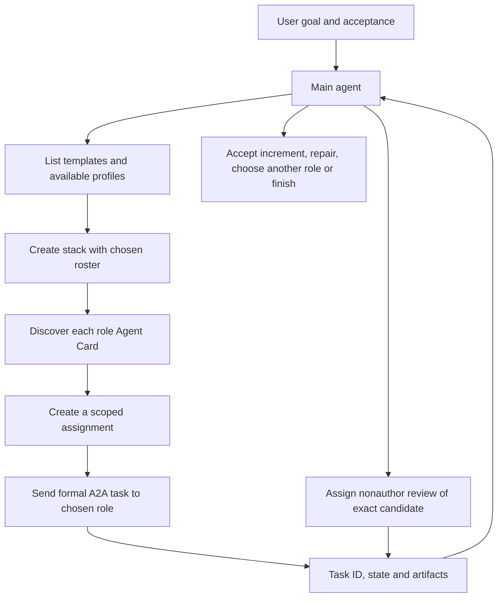

# Main-agent selected A2A teams

The main agent is the controller. It chooses a template or an explicit roster for the current goal, creates a stack instance, and decides which role receives the next assignment. A timer is an optional wakeup mechanism; it does not choose the team or prescribe a permanent workflow.



Templates are reusable recipes. Stack IDs, role identities, assignments and A2A task IDs belong to one run. A new assignment is not a repeat of a consumed assignment. Different roles have distinct official-SDK Agent Cards, handlers and task stores; each assigned Claude task starts a separate CLI context. The current backend is the installed Claude Code harness. This is not a registry of arbitrary remote providers.

## Main-agent tool sequence

Through the MCP gateway:

1. `list_templates()` returns templates and available role profiles.
2. `create_stack(workspace, goal, template_name, roles, name)` records the selected team. Supply a template or an explicit roster; there is no implicit permanent team.
3. `discover_agent(stack_id, role_id)` returns that role's actual Agent Card.
4. `create_assignment(stack_id, role_id, task, write_paths, acceptance, candidate, depends_on)` creates a scoped leaf assignment and returns its `job_name`.
5. `submit_job(job_name, stack_id, role_id)` sends that assignment through the official A2A SDK to the selected card.
6. `get_task(task_id, stack_id, role_id)` polls the original task. `cancel_task` and `list_tasks` use the same routing fields.
7. The main agent inspects real artifacts/checks, freezes the candidate, then assigns a different reviewer role that did not author that scope. A worker's COMPLETED state does not certify QA.

Example roster selected by the main agent, rather than imposed by a timer:

```json
{
  "workspace": "D:/github/northstar",
  "goal": "Deliver one verified implementation increment",
  "template_name": "code-review",
  "name": "implementation-with-context",
  "roles": [
    {"id": "context", "profile": "researcher"},
    {"id": "implementer", "profile": "coder"},
    {"id": "critic", "profile": "reviewer"}
  ]
}
```

A research-only goal may select a single researcher. The main agent can create another stack with a different roster when its needs change. It need not start every available role or use a template. The host currently accepts its explicitly configured workspace; another workspace is rejected instead of silently redirected.

## Responsibilities and signals

| Signal | Main-agent action |
| --- | --- |
| SUBMITTED / WORKING | Track the original role and task ID; do not duplicate a write task |
| COMPLETED + artifact | Inspect the actual increment; send candidate-bound independent review |
| FAILED / REJECTED / CANCELED | Inspect the cause and decide whether to repair or create a new assignment |
| Missing task after host restart | Reconcile persisted assignment binding, receipts and files; never blindly resend |
| READY review of matching candidate | Accept that increment, then choose the next useful assignment |
| NOT READY / UNVERIFIED / stale candidate | Keep acceptance open; send precise repair or obtain missing evidence |

Dependency edges are run-plan metadata. The main agent enforces ordering by checking actual A2A states; the runtime does not silently execute a fixed DAG. The controller stays outside the worker execution queue, so it can await a worker and then dispatch another role without waiting on itself.

Reviewers have no Edit/Write/Bash tools. They review source and evidence in a separate context; independent functional execution remains a separate verification responsibility. Coder tool access follows the explicit assignment scope, which is an instruction boundary, not an OS sandbox.

## Host control and protocol endpoints

The local host control API exposes `/control/templates`, `/control/stacks` and `/control/stacks/{id}/assignments`. It creates trusted assignment configurations from available profiles; it does not accept arbitrary executables, model overrides or remote URLs.

Each role is discoverable at:

```text
http://127.0.0.1:18890/stacks/STACK_ID/agents/ROLE_ID/.well-known/agent-card.json
```

Use the full card URL with the official A2A CLI; its host shorthand can discard a base path. The card advertises its own JSON-RPC endpoint. In Docker, the MCP adapter retargets only the host/scheme while preserving that role path.

The official SDK task stores use per-agent SQLite databases. Stack/assignment identity, task binding, goal/session state and protocol artifacts persist across restart. Interrupted execution is diagnosed automatically and continued by the main agent using current files and evidence; unknown write operations are never blindly replayed. This local hybrid workflow does not claim full TCK coverage or arbitrary-provider federation.
